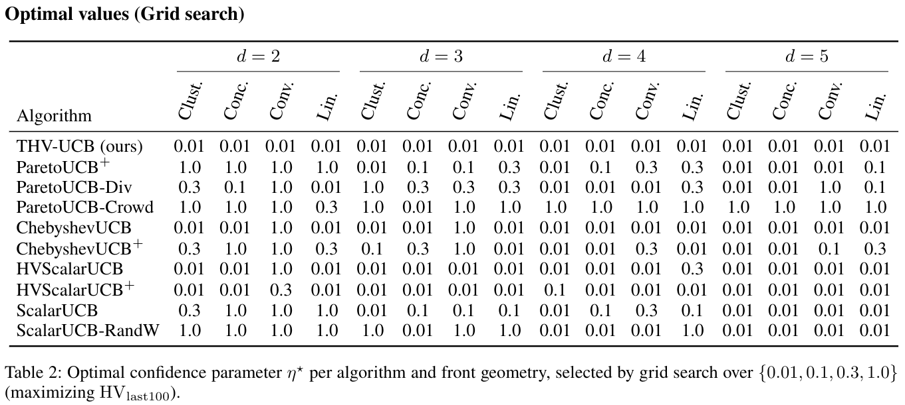
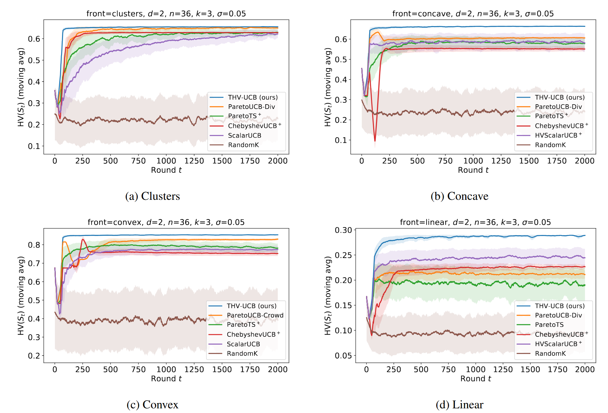
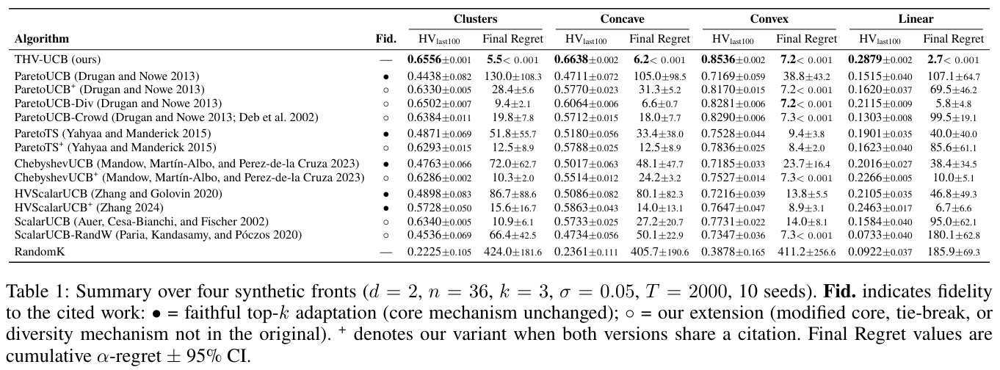
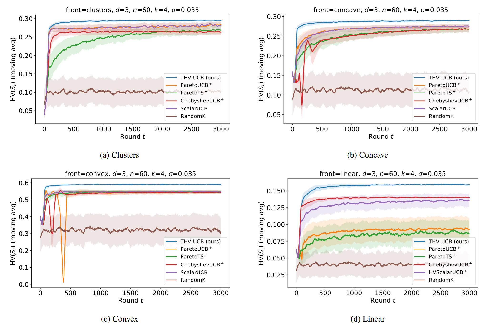
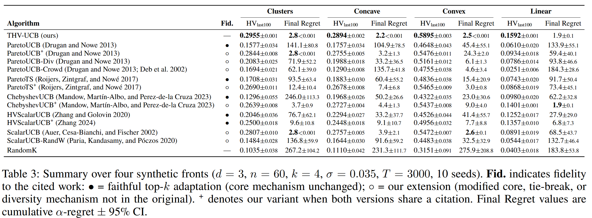
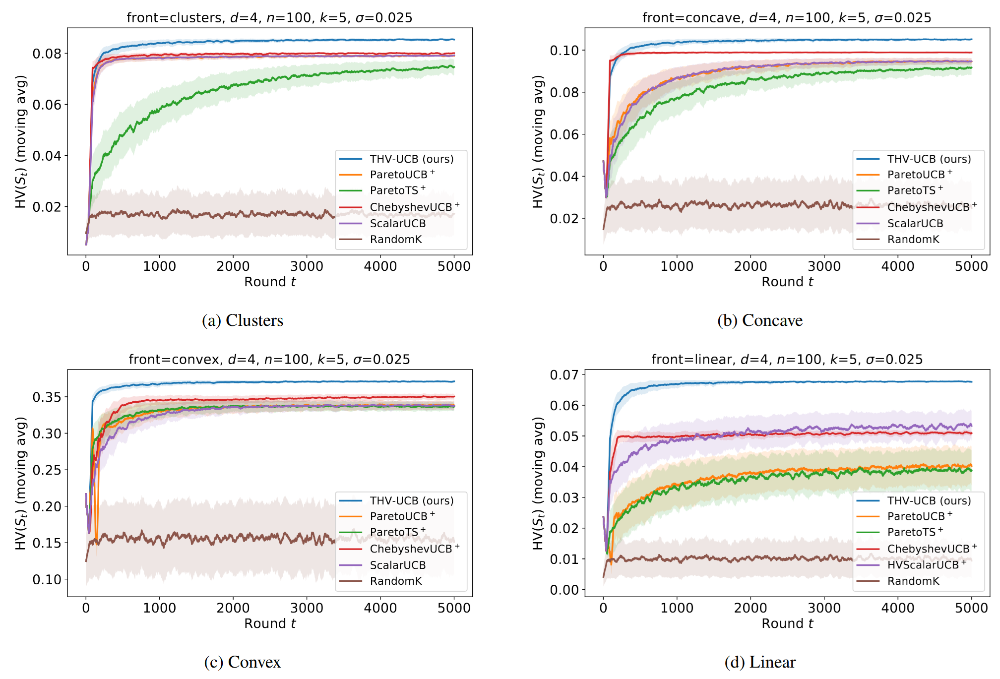
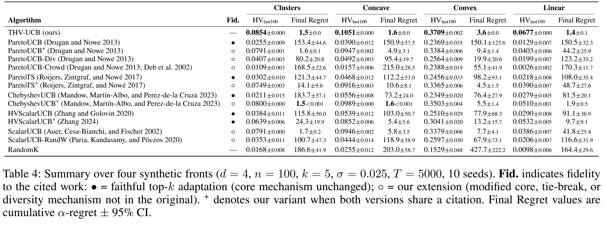
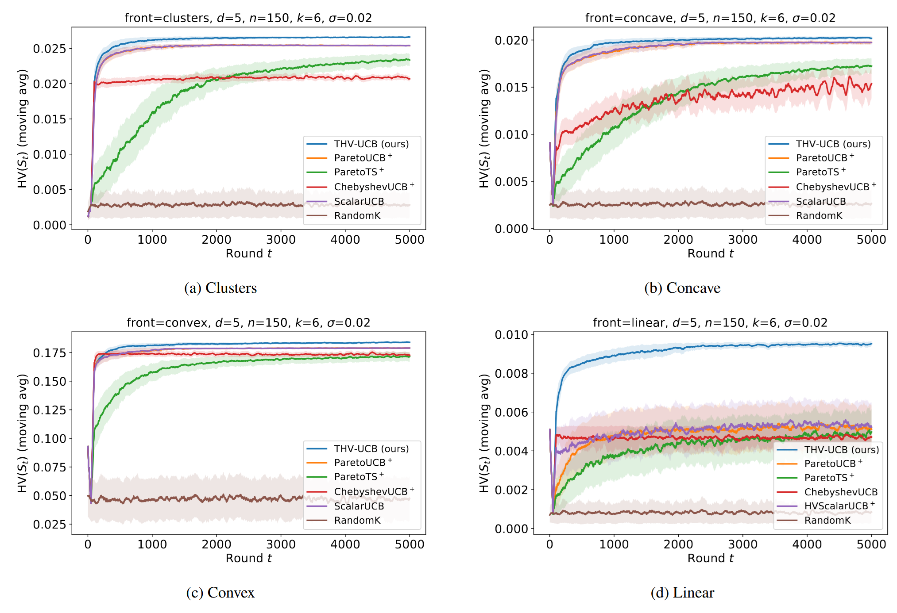
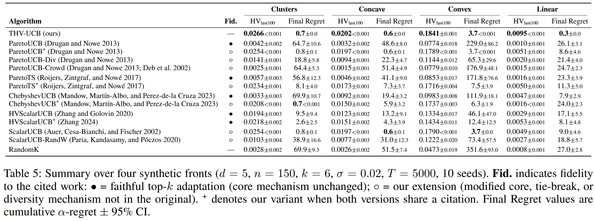

# Top-k Pareto Bandits: Hypervolume Regret for Multi-Objective Slate Selection

Code for the paper *"Top-k Pareto Bandits: Hypervolume Regret for Multi-Objective Slate Selection"*, submitted to AAAI 2027.

---

## Overview

This repository implements **THV-UCB**, an optimistic algorithm for the Top-k Pareto bandit problem, together with 13 baselines adapted to the top-k semi-bandit setting. The agent selects a slate of k arms per round and is evaluated by the dominated hypervolume of the selected subset relative to the best ε-cover of the Pareto frontier.

---

## Files

| File | Description |
|---|---|
| `model.py` | All algorithm classes, environment generation, hypervolume utilities, and runner |
| `exec.py` | Main experiment script - parse args, run all algorithms, save results and plots |

---

## Requirements

```
numpy
matplotlib
```

No other dependencies. The hypervolume is computed exactly via inclusion-exclusion (tractable for small k).

---

## Usage

```bash
python exec.py <front> <d> <n> <n_front> <k> <sigma> <eps> <T> <eta>
```

**Parameters:**

| Argument | Description |
|---|---|
| `front` | Pareto front geometry: `linear`, `convex`, `concave`, `clusters` |
| `d` | Number of objectives |
| `n` | Total number of arms |
| `n_front` | Number of arms on the Pareto front |
| `k` | Slate size |
| `sigma` | Observation noise (Gaussian) |
| `eps` | legacy parameter, unused (kept for CLI compatibility) |
| `T` | Horizon (number of rounds) |
| `eta` | Confidence parameter η (grid-searched over {0.01, 0.1, 0.3, 1.0}) |

**Examples:**

```bash
# d=2, paper default config
python exec.py concave 2 36 12 3 0.05 0.05 2000 0.01

# d=5
python exec.py clusters 5 150 70 6 0.02 0.2 5000 0.01
```

**Outputs** (saved in `results/` and `figures/`):
- `results_{tag}.pkl` - full results dict (pickle)
- `Regret_{tag}.png` - Final regret and hypervolume (last 100 trials) 
- `HV_{tag}.png` - hypervolume trajectory (moving average, w=50)
- `gridsearch.png` - grid search (optimal η* per algorithm/geometry) summary

---

## Experimental configurations

| d | n | n_front | k | σ | ε | T |
|---|---|---|---|---|---|---|
| 2 | 36 | 12 | 3 | 0.05 | 0.05 | 2000 |
| 3 | 60 | 30 | 4 | 0.035 | 0.1 | 3000 |
| 4 | 100 | 50 | 5 | 0.025 | 0.15 | 5000 |
| 5 | 150 | 70 | 6 | 0.02 | 0.2 | 5000 |

All results are averaged over 10 random seeds. η is selected per algorithm and front geometry via grid search.

**Note on ε:** legacy CLI parameter, inherited from an earlier ε-cover formulation of the benchmark that was not retained in the final analysis (Problem Setting, Eq. 2). Values are recorded above for reproducibility of the exact commands used; ε does not enter the regret bounds of Section 5 or the definition of the benchmark $V^\star$ used to report results.

---

## Algorithms

### THV-UCB (ours)
Coordinate-wise UCB boxes + safe pruning (LCB/UCB dominance) + greedy selection by optimistic marginal hypervolume gain.

### Baselines

| Class in `model.py` | Paper name | Fidelity | Reference |
|---|---|---|---|
| `ParetoUCB_TopK_DR` | ParetoUCB | • faithful | Drugan & Nowé, IJCNN 2013 (See our paper for details) |
| `ParetoUCB_TopK` | ParetoUCB+ | ◦ extension | Drugan & Nowé, IJCNN 2013 (See our paper for details)  |
| `ParetoUCB_DiverseTopK` | ParetoUCB-Div | ◦ extension | Drugan & Nowé, IJCNN 2013 (See our paper for details) |
| `ParetoUCB_CrowdingTopK` | ParetoUCB-Crowd | ◦ extension | Drugan & Nowé + Deb et al., 2002 (See our paper for details) |
| `ParetoTS_Faithful_TopK` | ParetoTS | • faithful | Yahyaa & Manderick, ESANN 2015 (See our paper for details) |
| `ParetoTSPlus_TopK` | ParetoTS+ | ◦ extension | Yahyaa & Manderick, ESANN 2015 (See our paper for details) |
| `ChebyshevUCB_Mandow` | ChebyshevUCB | • faithful | Mandow et al., MODeM@ECAI 2023 (See our paper for details) |
| `ChebyshevUCB` | ChebyshevUCB+ | ◦ extension | Mandow et al., MODeM@ECAI 2023 (See our paper for details) |
| `HVScalarUCB` | HVScalarUCB | • faithful | Zhang & Golovin, ICML 2020 (See our paper for details) |
| `HVScalarUCB_Zhang2024` | HVScalarUCB+ | • faithful | Zhang, NeurIPS 2024 (See our paper for details) |
| `ScalarUCB` | ScalarUCB | ◦ extension | Auer et al., 2002 (See our paper for details) |
| `ScalarUCB_RandW` | ScalarUCB-RandW | ◦ extension | Paria et al., UAI 2020 (See our paper for details)  |
| `RandomK` | RandomK | - | - |

**Fidelity:** • = faithful top-k adaptation (core mechanism unchanged); ◦ = our extension (modified confidence term, tie-break, or diversity mechanism).

---

## Results
Full results for all dimensions (d ∈ {2, 3, 4, 5}) and front geometries
are available in `results/` (raw `.pkl`) and `figures/` (plots).

All grid search results (optimal η* per algorithm/geometry) will be published in a separate web page after AAAI reviews. They are summarized below: 
<br><br>


---

### Two objectives (d=2, k=3)

This Figure summarizes over four synthetic fronts (_d=2, n=36, k=3, σ=0.05, T=2000, 10 seeds_).
**Fid.** indicates fidelity to the cited work: • = faithful top-k adaptation (core mechanism unchanged); ◦ = our extension (modified core, tie-break, or diversity mechanism not in the original). + denotes our variant when both versions share a citation. Final Regret values are cumulative α-regret +/- 95\% CI.
<br><br>



---

### Three objectives (d=3, k=4)

This Figure summarizes over four synthetic fronts (_d=3, n=60, k=4, σ=0.035, T=3000, 10 seeds_).
**Fid.** indicates fidelity to the cited work: • = faithful top-k adaptation (core mechanism unchanged); ◦ = our extension (modified core, tie-break, or diversity mechanism not in the original). + denotes our variant when both versions share a citation. Final Regret values are cumulative α-regret +/- 95\% CI.
<br><br>



---

### Four objectives (d=4, k=5)

This Figure summarizes over four synthetic fronts (_d=4, n=100, k=5, σ=0.025, T=5000, 10 seeds_).
**Fid.** indicates fidelity to the cited work: • = faithful top-k adaptation (core mechanism unchanged); ◦ = our extension (modified core, tie-break, or diversity mechanism not in the original). + denotes our variant when both versions share a citation. Final Regret values are cumulative α-regret +/- 95\% CI.
<br><br>



---

### Five objectives (d=5, k=6)

This Figure summarizes over four synthetic fronts (_d=5, n=150, k=6, σ=0.02, T=5000, 10 seeds_).
**Fid.** indicates fidelity to the cited work: • = faithful top-k adaptation (core mechanism unchanged); ◦ = our extension (modified core, tie-break, or diversity mechanism not in the original). + denotes our variant when both versions share a citation. Final Regret values are cumulative α-regret +/- 95\% CI.
<br><br>



